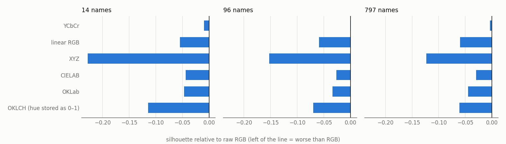
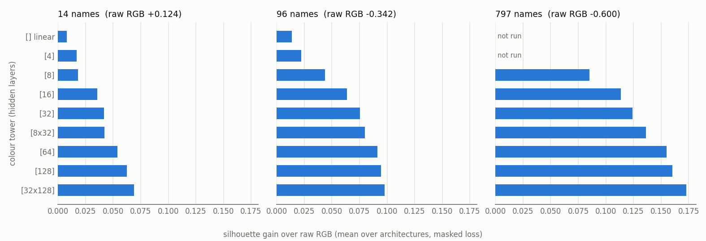

# Geometry: how well colour names separate

How cleanly the names form groups — in raw colour spaces with no model, and in the
learned colour embedding — and which settings change it. Learned silhouette and R@1
come directly from `experiments/*/experiment_results.csv` and `experiments/*/metrics/*_per_name.csv`.
Regenerate with `python annexes/geometry/build.py`.

**The short answer.** Names are barely groups at all in raw colour: above 14 names the
average sample sits closer to another name's centre than to its own. No hand-designed
colour space does better than plain RGB. Training improves separation at every colour
count, and the colour tower is the main lever — a second hidden layer beats a wider single
one in 46 of 46 matched comparisons at 96 names and 30 of 30 at 797. Accuracy and geometry are different
questions — some changes help one and cost the other.

## Metric

Silhouette per sample: `(b − a) / max(a, b)`, where `a` is the distance to its own name's
centre and `b` to the nearest other name's centre. +1 is cleanly separated, 0 is on the
border, negative is closer to another name. This is the simplified (centroid) form;
the textbook all-pairs form compares every sample with every other and is infeasible on
600k samples. Centres come from all clean test rows; scoring uses a stratified 60k sample of them.
"Overall" weights names by sample count.

## 1. Raw colour spaces (no model)

| space | 14c | 96c | 797c |
|---|---|---|---|
| RGB | +0.124 | -0.342 | -0.600 |
| YCbCr | +0.115 | -0.342 | -0.604 |
| linear RGB | +0.070 | -0.401 | -0.660 |
| XYZ | -0.103 | -0.495 | -0.723 |
| CIELAB | +0.080 | -0.369 | -0.630 |
| OKLab | +0.077 | -0.376 | -0.645 |
| OKLCH (hue stored as 0–1) | +0.010 | -0.412 | -0.661 |

RGB and YCbCr (a linear re-mix of RGB) are at the top at every colour count. Every
perceptually-uniform space — CIELAB, OKLab — is worse: spaces built so that distance
matches perceived difference group *names* less well than device RGB. The OKLCH row is
the form `rgb_to_oklch` produces: hue stored as a plain number from 0 to 1, so 0.99 and
0.01 look far apart although they are neighbouring hues. That costs it against OKLab (the
same colours, without the wrap-around). Models only see this form with
`color_space: "oklch"`, which was used only in the 5th round — where it made no accuracy
difference (−0.0001 R@1 vs RGB over 432 paired runs). Every other round uses RGB.

## 2. Learned embedding vs raw RGB

| names | raw RGB | best model | gain | model |
|---|---|---|---|---|
| 14 | +0.124 | +0.206 | +0.082 | mask dim64 ch[32x128] th[128] |
| 96 | -0.342 | -0.235 | +0.107 | mask dim256 ch[32x128] th[256x512] |
| 797 | -0.600 | -0.416 | +0.184 | mask dim128 ch[32x128] th[256x512] |

The gain grows from 14 to 797 names. **Control:** a randomly
initialised network of the 96c reference shape (dim64, ch[16], th[256]) scores
-0.359, -0.338, -0.349 — no better than raw RGB (-0.342) — so the
gain is learned, not a side effect of mapping 3 dimensions into 64.

## 3. The colour tower

Mean gain over raw RGB per colour tower (masked loss, the only loss run across the whole
grid; `—` = never run):

| colour tower | 14c | 96c | 797c |
|---|---|---|---|
| [] (linear) | +0.008 | +0.014 | — |
| [4] | +0.017 | +0.022 | — |
| [8] | +0.018 | +0.044 | +0.085 |
| [16] | +0.036 | +0.064 | +0.113 |
| [32] | +0.042 | +0.075 | +0.124 |
| [8x32] | +0.042 | +0.080 | +0.136 |
| [64] | +0.054 | +0.091 | +0.155 |
| [128] | +0.062 | +0.094 | +0.160 |
| [32x128] | +0.069 | +0.098 | +0.173 |

Matched pairs — same colour count, loss, embedding size and text tower; only the colour
tower changes:

| tower change | names | wider better | mean gain | p (sign test) |
|---|---|---|---|---|
| [16] -> [32x128] | 14 | 5 / 9 | +0.008 | 1 |
| [16] -> [32x128] | 96 | 46 / 46 | +0.026 | 3e-14 |
| [16] -> [32x128] | 797 | 30 / 30 | +0.054 | 2e-09 |
| [16] -> [64] | 14 | 12 / 16 | +0.009 | 0.08 |
| [16] -> [64] | 96 | 46 / 46 | +0.017 | 3e-14 |
| [16] -> [64] | 797 | 30 / 30 | +0.033 | 2e-09 |
| [64] -> [32x128] | 14 | 4 / 10 | -0.000 | 0.8 |
| [64] -> [32x128] | 96 | 43 / 47 | +0.009 | 3e-09 |
| [64] -> [32x128] | 797 | 32 / 32 | +0.020 | 5e-10 |
| [128] -> [32x128] | 14 | 2 / 8 | -0.006 | 0.3 |
| [128] -> [32x128] | 96 | 40 / 45 | +0.008 | 8e-08 |
| [128] -> [32x128] | 797 | 30 / 30 | +0.014 | 2e-09 |

At 96 and 797 names this is not noise: a retrained identical config moves silhouette by
about 0.003 (sd), the gains are 10–25× that, and the pairs go the same way.
At 14 names the tower does not matter.
`[32,128]` beating `[128]` means the second layer matters, not only width.

**It is not free for every loss.** R@1 change for `[16] → [32,128]`:

| loss | names | pairs | silhouette | R@1 | pairs where R@1 rose |
|---|---|---|---|---|---|
| mask | 96 | 15 | +0.024 | -0.005 | 0 |
| mask | 797 | 9 | +0.053 | -0.008 | 0 |
| orig | 96 | 15 | +0.026 | -0.003 | 2 |
| orig | 797 | 10 | +0.056 | -0.002 | 4 |
| proto | 96 | 1 | +0.025 | +0.002 | 1 |
| proto | 797 | 1 | +0.027 | +0.001 | 1 |
| supc | 96 | 15 | +0.026 | -0.003 | 3 |
| supc | 797 | 10 | +0.056 | -0.002 | 4 |

Masked pays ~0.5–0.9 R@1 points. Prototype has a single matched pair per colour count, so
its "free" reading is one observation, not a test.

## 4. Other settings (96 names)

**t→c weight × batch size** (14th round, prototype dim64 ch[64] th[256]) — silhouette:

| t→c weight | batch 96 | batch 512 | batch 2048 |
|---|---|---|---|
| 0 | -0.264 | -0.260 | -0.255 |
| 0.1 | -0.260 | -0.257 | -0.253 |
| 1 | -0.265 | -0.262 | -0.260 |
| 10 | -0.273 | -0.266 | -0.262 |

The ranking is identical at all three batch sizes: 0.1 best, off second, the default 1
third, 10 worst. Larger batches are better at every weight. R@1 across all twelve runs
spans 0.4850–0.4858.

**Starting temperature** (prototype dim64 ch[16] th[256], one run each):
0.02 → -0.284, 0.07 → -0.278, 0.2 → -0.272; R@1
0.4837–0.4844. Higher is better so far; nothing above 0.2 was run.

**Learning rate** (12th round, 1e-5 … 3e-3, dim32 ch[16] th[]): silhouette range per loss
mask -0.284 … -0.263; orig -0.292 … -0.273; proto -0.286 … -0.277; supc -0.292 … -0.268,
Original and supcon improve at every step up in learning rate (about +0.02 over the range);
prototype and masked show no direction. The 17th round (lr 0.01–0.5) is in report_8th_to_18th.md.

## 5. Prototype vs masked, same architecture

| names | R@1 (proto − mask) | silhouette (proto − mask) | pairs | proto ahead on silhouette | p (sign test) |
|---|---|---|---|---|---|
| 14 | +0.003 | -0.011 | 3 | 1 | 1 |
| 96 | +0.049 | -0.015 | 28 | 4 | 0.0002 |
| 797 | +0.119 | -0.005 | 5 | 1 | 0.4 |

Prototype is more accurate at every colour count, by more as names grow. Its geometry is
worse at 96 names and level at 797.

## 6. Are better-separated models more accurate?

Spearman correlation between silhouette and R@1 across architectures (default
hyperparameters; `—` = fewer than 8 architectures):

| names | all losses pooled | proto | mask | orig | supc |
|---|---|---|---|---|---|
| 14 | +0.11 | — | +0.82 (n=84) | +0.49 (n=75) | +0.43 (n=77) |
| 96 | +0.03 | +0.96 (n=28) | +0.51 (n=162) | -0.12 (n=162) | -0.13 (n=162) |
| 797 | +0.39 | — | +0.49 (n=113) | +0.42 (n=112) | +0.42 (n=114) |

Pooled over all losses the two look unrelated at 96 names. That is an artefact of mixing
losses: prototype models are accurate with average separation, masked models the reverse,
so pooling cancels the relationship inside each. Within prototype — the loss we use — the
architecture that separates best is almost exactly the one that is most accurate.

## 7. Who gains and who pays (96 names, reference model)

The model improves 86 of 96 names, overall -0.342 → -0.275.
It changes the numbers more than the order: per-name silhouette in RGB vs learned,
Spearman 0.891. It spends its separation where names are
tangled: names in the more tangled half gain +0.092 on average, the
better-separated half +0.042 (Spearman of change vs starting
silhouette -0.479). The loss only asks each sample to be on
the right side of a boundary; nothing rewards a tight cluster once it is correct.

Largest losses:

| name | silhouette_rgb | silhouette_learned | change |
|---|---|---|---|
| black | +0.314 | +0.056 | -0.258 |
| gray light | +0.210 | +0.042 | -0.168 |
| blue bright | -0.195 | -0.284 | -0.089 |
| brown dark | -0.014 | -0.067 | -0.052 |
| yellow | +0.143 | +0.108 | -0.035 |
| dark pink | -0.261 | -0.281 | -0.020 |
| orange | -0.171 | -0.176 | -0.005 |
| light pink | +0.058 | +0.055 | -0.003 |

Largest gains:

| name | silhouette_rgb | silhouette_learned | change |
|---|---|---|---|
| gray purple | -0.234 | -0.047 | +0.187 |
| gray | -0.364 | -0.177 | +0.188 |
| khaki | -0.480 | -0.289 | +0.191 |
| taupe | -0.497 | -0.285 | +0.211 |
| gray green | -0.305 | -0.044 | +0.262 |

Full list: `per_class_96c.csv`. Per-name scores for individual runs are stored in
`experiments/<round>/metrics/<exp>_per_name.csv`.

## Method notes

- **Noise floor.** 2 configs were retrained with identical settings and seed; pooled sd
  0.0026 silhouette, 0.0004 R@1. Across the 16th round's three seeds (which
  also change the train/test split), silhouette moves by about 0.002 (96 names) to 0.004
  (797 names), sd per setting.
- **Simplified vs exact silhouette** (96c, 10k sample): raw RGB -0.336 vs
  -0.236, learned -0.270 vs -0.205. The simplified form
  reads more tangled and more improved; it ranks models the same way. Do not quote it as
  the textbook number.
- **Sample size does not matter.** Overall silhouette at 15k / 30k / 60k:
  RGB -0.344, -0.342, -0.342; learned
  -0.277, -0.275, -0.275.
- **Centres come from all clean test rows, not the sample.** An earlier version computed
  them from the 60k sample, which left many rare names with no sample or only a few rows.
- **Clean rows only.** Every model is scored on its own split's test rows after the first
  5,000, which chose its epoch (research_plan.md note 10). 5,363 names are left out: after
  removing those rows, some names have one clean row or none.
- **Coverage.** 1292 runs across rounds 7th through 22nd
  at 14, 96 and 797 names. Gaps that remain show as `—` in the tower table.
