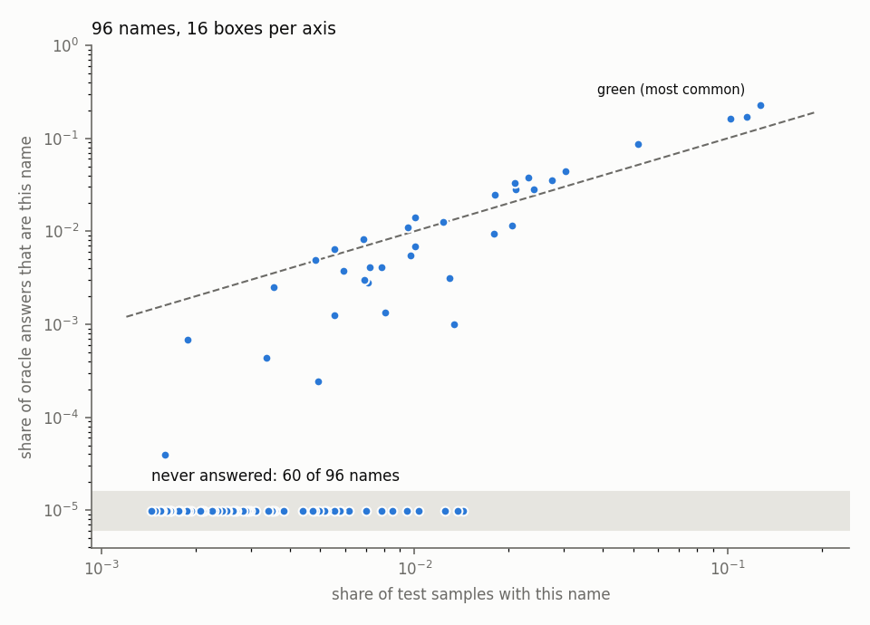

# Plurality Oracle: the best lookup table, and what its silhouette means

A classifier with no learning. Cut the RGB cube into equal boxes; in each box, answer with
the name people gave most often there. Built on the training split, scored on the test
split. Regenerate with `python annexes/plurality_oracle/build.py`.

**The short answer.** For a given box size this is the most accurate answer any rule
based on that box can give, and our model matches it. Above 14 names it only ever says a
minority of the names — the rest are outnumbered in every box. Its silhouette is not a
geometry benchmark: placing each sample exactly on its answer makes right answers look
perfectly tight and wrong answers maximally misplaced, so the score mostly restates
accuracy. At 14 names that makes it look better than any model; above that, worse.

## Parameters

| | |
|---|---|
| split | test_size 0.2, stratified, seed 42 — the same as every experiment |
| box sizes | 8³, 16³, 32³, 64³ boxes (32, 16, 8, 4 RGB units wide) |
| empty boxes | answer with the overall most common name |
| reference model | prototype, dim64, colour tower [16], text tower [256] (10th round) |
| silhouette | centroids from the full test set, scored on a stratified 60k sample |

## 1. Accuracy

| names | boxes | box width (RGB units) | R@1 | R@1 per name | names that win a box | names ever answered |
|---|---|---|---|---|---|---|
| 14 | 8 | 32 | 0.7471 | 0.6061 | 13 | 13 |
| 14 | 16 | 16 | 0.7638 | 0.6233 | 13 | 13 |
| 14 | 32 | 8 | 0.7633 | 0.6261 | 14 | 14 |
| 14 | 64 | 4 | 0.7243 | 0.5911 | 14 | 14 |
| 96 | 8 | 32 | 0.4673 | 0.1135 | 28 | 28 |
| 96 | 16 | 16 | 0.4806 | 0.1271 | 36 | 36 |
| 96 | 32 | 8 | 0.4786 | 0.1313 | 71 | 71 |
| 96 | 64 | 4 | 0.4301 | 0.1332 | 96 | 96 |
| 797 | 8 | 32 | 0.3933 | 0.0142 | 27 | 27 |
| 797 | 16 | 16 | 0.4048 | 0.0159 | 42 | 42 |
| 797 | 32 | 8 | 0.4032 | 0.0164 | 82 | 82 |
| 797 | 64 | 4 | 0.3594 | 0.0172 | 682 | 670 |
| 5363 | 8 | 32 | 0.3738 | 0.0021 | 29 | 29 |
| 5363 | 16 | 16 | 0.3845 | 0.0024 | 42 | 42 |
| 5363 | 32 | 8 | 0.3827 | 0.0024 | 80 | 80 |
| 5363 | 64 | 4 | 0.3400 | 0.0026 | 1956 | 1863 |

The model, for comparison (full test set):

| names | R@1 | R@1 per name | names ever answered |
|---|---|---|---|
| 14 | 0.7687 | 0.6271 | 13 |
| 96 | 0.4840 | 0.1335 | 47 |
| 797 | 0.4071 | 0.0165 | 48 |
| 5363 | 0.3879 | 0.0025 | 49 |

At its best box size (16 per axis) the lookup table is within 0.005 of the model at every
colour count — the "we are at the ceiling" result of research_plan.md note 1. Smaller boxes let
more names win somewhere but have fewer training samples per box, and accuracy falls.
"Best for a box size" is not a ceiling in general.

## 2. Most names are never answered

Each dot is one of the 96 names: how often it is the true label (x) against how often the
oracle answers it (y). Common names sit above the dashed line — the oracle says them more
often than they occur — and 60 names sit on the band at the
bottom: the oracle never says them, because in every box some other name is more common.
That is note 3 ("the tail is unreachable by argmax"). Full list: `name_shares_96c.csv`.

## 3. Silhouette: it mostly restates accuracy

| names | oracle boxes | raw RGB | model | oracle | raw RGB (per name) | model (per name) | oracle (per name) |
|---|---|---|---|---|---|---|---|
| 14 | 16 | +0.125 | +0.159 | +0.381 | +0.152 | +0.183 | +0.186 |
| 96 | 16 | -0.341 | -0.273 | -0.400 | -0.282 | -0.214 | -0.487 |
| 797 | 16 | -0.597 | -0.475 | -0.739 | -0.568 | -0.432 | -0.736 |
| 5363 | 16 | -0.797 | -0.684 | -0.973 | -0.771 | -0.636 | -0.891 |

The oracle's silhouette is better than the model's at 14 names and worse above that.
The split by sample type (best box size) shows why:

| names | group | share of samples | oracle | model | raw RGB |
|---|---|---|---|---|---|
| 14 | right answer | 76.3% | +0.715 | +0.265 | +0.221 |
| 14 | wrong answer | 21.4% | -0.718 | -0.196 | -0.193 |
| 14 | name never answered | 2.3% | -0.469 | -0.041 | -0.086 |
| 96 | right answer | 48.1% | -0.174 | -0.230 | -0.301 |
| 96 | wrong answer | 28.3% | -0.659 | -0.377 | -0.429 |
| 96 | name never answered | 23.6% | -0.552 | -0.237 | -0.315 |
| 797 | right answer | 40.3% | -0.689 | -0.464 | -0.591 |
| 797 | wrong answer | 25.7% | -0.777 | -0.541 | -0.643 |
| 797 | name never answered | 34.0% | -0.769 | -0.438 | -0.570 |
| 5363 | right answer | 38.5% | -0.989 | -0.681 | -0.796 |
| 5363 | wrong answer | 24.2% | -0.966 | -0.723 | -0.823 |
| 5363 | name never answered | 37.3% | -0.962 | -0.662 | -0.782 |

Each sample is placed exactly on its answer. A right answer sits on top of its own group
(very high silhouette); a wrong answer sits on top of another group (very low). The model
keeps each colour's position, so it is less extreme in both directions. The oracle's
overall score is therefore set by how many answers are right: 76% at 14 names (it wins),
under half at 96 names with a quarter of samples belonging to names it never says (it
loses). The answer vectors are also all equally far apart, so the oracle has no notion
that "light blue" is close to "blue". Use this as a warning about the metric, not as a
geometry target: a hard classifier's silhouette tracks its accuracy.

## Notes

- The oracle's embedding is the one-hot vector of its answer; its silhouette is computed
  exactly, not sampled from a model.
- Ties within a box go to the lower name index (`argmax`).
- An earlier version of this analysis built the boxes on the test set itself; this one
  uses the training split, so it is a fair comparison with the model.
