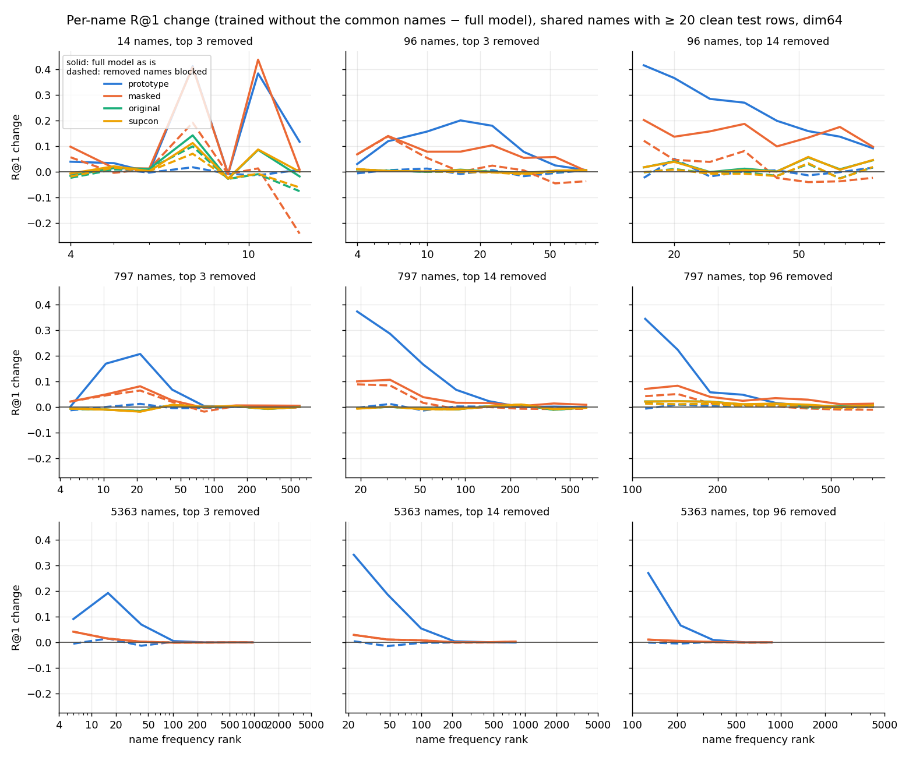

# Report on rounds 8 to 18

What each round asked, what we expected, what came out, and whether the claims in
`research_plan.md` hold when checked against the data. Replaces `report_8th_to_10th.md`.
Written 2026-10-27, numbers updated 2026-10-29.

## Summary

1. **Accuracy is settled.** No setting tried since the 8th round moves prototype R@1 by more
   than about 0.005. That includes model size, the learning rate (from 1e-5 to 0.5), the
   starting temperature, the weight of the name → colour direction and pixel tolerance.
2. **No loss is best on every measure.** Prototype is best overall (common colours count
   more); original and supcon are best per name (every name counts the same). Masked is in
   between. This holds at every vocabulary size.
3. **Separation has one main lever.** A colour network with two hidden layers (32 and 128
   units) separates names better than one layer and costs a little R@1. Going further does
   not help: a third layer, wider layers (64 and 256 units) or a higher starting temperature
   are level or worse, and neither a learning rate above 3e-3 nor pixel tolerance improves
   it.
4. **No round has worked on generalisation or scoring**, the two questions the plan names as
   open.

## Terms

| term | meaning |
|---|---|
| R@k | For each test row the model ranks all names, most likely first. R@k is the share of test rows whose true name is among the first k. R@1 is plain accuracy. |
| overall | Average over test rows. Common names have more rows, so they weigh more. |
| per name | The score is computed for each name on that name's rows only, then averaged over names. Every name weighs the same, rare ones included. |
| dim | How many numbers the model uses to describe a colour or a name (embedding size). |
| colour network, text network | The layers that turn an RGB value (or a name) into those numbers. Colour [32,128] = two hidden layers of 32 and 128 units; [] = no hidden layer, a straight linear map. |
| model shorthand | "dim64, colour [16], text [256]" means 64 numbers per colour and per name, a colour network with one hidden layer of 16 units, and a text network with one hidden layer of 256 units. This is the reference model from the 10th round on. |
| c→t, t→c | Colour → name: given a colour, pick its name (what R@k measures). Name → colour: given a name, pick its colour among the colours of the training batch. The t→c weight sets how much the second direction counts in the loss. |
| temperature | A number that sharpens or flattens the model's scores before they become probabilities. The model learns it during training; the "starting temperature" is the value it begins from (0.07 unless stated). |
| pixel tolerance (ε), look-alike | In the t→c direction, a colour of the batch within ε RGB units of the right one on every channel also counts as right. Such a colour is a look-alike. ε 0 means no tolerance, the original behaviour (18th round). |
| MRR | Mean reciprocal rank: 1 divided by the position of the true name in the model's ranking, averaged over rows. Training uses it on the first 5,000 test rows to decide which epoch is best and when to stop. |
| patience | How many epochs training continues without MRR improving before it stops. 50 up to the 9th round and in the 12th; 20 in the other rounds from the 10th on. |
| note N, task N, row N | Numbered sections of `research_plan.md`. |

## Two scores explained

### Youden's J

Youden's J asks, for one name, whether the model suggests that name when it is the right
answer more often than when it is not. Take name *c* and a cut-off *k* (k = 1: only the top
name counts; k = 5: any of the first five).

- *n_c* = test rows whose true name is *c*; *N* = all test rows.
- *TP_c* = rows of name *c* that have *c* among their first *k* names (hits).
- *FP_c* = rows of **other** names that have *c* among their first *k* (false alarms).

```
hit rate          = TP_c / n_c
false-alarm rate  = FP_c / (N − n_c)
J_c@k             = hit rate − false-alarm rate
```

J is 1 when the model suggests *c* on every row of *c* and on no other row. It is 0 when the
model suggests *c* equally often on rows of *c* and on rows of other names, so the suggestion
carries no information; guessing at random gives 0.

Example with made-up numbers, 96 names: "teal" has 1,000 test rows and is the top name on 600 of them (hit rate
0.60). Among the other 479,719 rows, teal is the top name on 4,797 (false-alarm rate 0.01).
J for teal at k = 1 is 0.60 − 0.01 = 0.59.

"Y@k overall" averages *J_c@k* over names weighted by their row counts *n_c*; "Y@k per name"
is the plain average over names. Code: `youdens_j_at_k` in `ML/metrics.py`.

### Silhouette (separation)

Silhouette measures how well the names separate from each other in a space: whether a
colour sits closer to the other colours with its own name than to those of any other name.
"Separation" in this report always means this number.

For test row *i* with name *y_i* and position *x_i* (its RGB value, or the numbers the colour
network outputs for it):

- the **centre** of name *c*, *μ_c*, is the average position of all test rows of *c*;
- *a_i* = distance from *x_i* to its own name's centre *μ_{y_i}*;
- *b_i* = distance from *x_i* to the nearest centre of any other name.

```
s_i = (b_i − a_i) / max(a_i, b_i)        between −1 and +1
```

- +1: much closer to its own name's centre than to any other;
- 0: as close to another name's centre as to its own (on the border);
- negative: closer to another name's centre than to its own.

Example: *a* = 0.3 and *b* = 0.6 give *s* = 0.3 / 0.6 = +0.5; swapped, *a* = 0.6 and *b* = 0.3
give −0.5.

Reported as the average of *s_i* over test rows ("overall") or the average of per-name
averages ("per name"). This is the centroid form of the silhouette: the textbook form compares
each row with every other row, which is infeasible at 600,000 rows. Centres come from all
clean test rows (see the next section); *s_i* is averaged over a fixed sample of 60,000 of
them, balanced by name. Raw RGB is scaled to 0–1; the model's output has length 1. Code:
`annexes/geometry/build.py`.

Silhouette is computed at 14, 96 and 797 names only. At 5,363 names many names have one clean
test row or none, so their centres can't be estimated.

## The four losses

All four train the same two networks (one for colours, one for names) on batches of survey rows
(2,048 in most rounds), each a (colour, name) pair. The model scores every colour against a set of names
and learns to give its own name the highest score. They differ only in what the colour is
compared with, and in what counts as a wrong answer.

| loss | each colour is compared with | rows of the batch with the same name |
|---|---|---|
| original | the names of all 2,048 rows in the batch | count as **wrong**: only its own row is right |
| masked | the same | are **left out** of the comparison |
| supcon | the same | count as **right** |
| prototype | the list of all names in the vocabulary, each once | do not arise: each name appears once |

Example with 96 names: "green" is 12.7% of the data, so a batch of 2,048 rows holds about
260 rows named "green" (the average name gets about 21). For a green colour, original counts
the other ~259 "green" rows as wrong answers, masked ignores them, supcon counts them as
right, and prototype compares the colour with the single "green" in the list of 96.

All four also train the other direction (name → colour: each name picks its colours among
the batch). Original and supcon give the same results to 3 decimals in every round.

## Where the numbers come from

During training, every epoch is scored on the first 5,000 rows of the test set, and the
best epoch is kept. Those 5,000 rows therefore helped choose the model, and a score that
includes them is a little too high. So every number in this report is computed on the
**clean rows**: all test rows after the first 5,000 (research_plan.md note 10). Each saved
model was loaded again after training and scored on them.

- **R@1, R@5, per-name scores:** all clean rows, 290,000 to 600,000 rows depending on the
  number of names. Two runs with the same settings and a different seed differ by about
  ±0.0007 R@1 (16th round).
- **Silhouette:** a fixed sample of 60,000 clean rows, balanced by name (geometry annex). It
  moves by about ±0.002 at 96 names and ±0.004 at 797 between seeds (16th round).
- **Untrained baselines** (lookup table, nearest centre, most common name) are scored on the
  same clean rows.

The clean rows are split into two halves, A and B, kept for choosing between models in
future rounds. Across all runs the two halves agree within chance, so they are reported
together here.

Every round used seed 42, which fixes the train/test split. The only exception is the 16th,
which also used seeds 7 and 123, to measure how much results move with a different split.

## The plan's main claim: accuracy is at the ceiling

The comparison is a lookup table with no learning (`annexes/plurality_oracle/`):

1. Cut the RGB cube into 16 × 16 × 16 = 4,096 equal boxes, each 16 RGB units wide.
2. For each box, count the names people gave to the training rows that fall in it, and keep
   the most common one. A box with no training rows gets the most common name overall.
3. To name a test colour, find its box and answer that box's name.

For a given box size, no rule that looks only at the box can be more accurate: answering the
most common name of the box is right as often as possible. Of the box sizes tried (8, 16, 32
and 64 per axis), 16 scores best. Smaller boxes have too few training rows each; larger boxes
lump different colours together.

| names | lookup table R@1 | model R@1 (prototype, 10th round) |
|---|---|---|
| 14 | 0.764 | 0.769 |
| 96 | 0.481 | 0.484 |
| 797 | 0.405 | 0.407 |
| 5,363 | 0.385 | 0.388 |

The model beats the table by 0.2–0.5 points, so the table is not a strict upper limit: it is
the best rule *for its box size*, and the model is not limited to boxes. The real
ceiling is at or a little above the model. The rest of the evidence agrees: nothing in rounds
8–18 moved prototype R@1 by more than about 0.005. The accurate wording is "no setting we
tried beats a memorising lookup table by more than half a point".

## The loss trade-off (8th and 10th rounds)

Best model per loss (8th: best of its grid by R@1; 10th: dim64, colour [16], text [256]).
"Centroid" = name the colour after the nearest name-average in RGB, no training; its
silhouette is that of raw RGB.

| names | model | R@1 | R@5 | per-name R@1 | per-name R@5 | silhouette |
|---|---|---|---|---|---|---|
| 14 | prototype (10th) | **0.769** | 0.996 | 0.627 | 0.993 | +0.158 |
| 14 | masked (8th) | **0.768** | 0.995 | 0.636 | 0.994 | +0.187 |
| 14 | original (8th) | 0.702 | 0.993 | **0.711** | 0.994 | +0.174 |
| 14 | centroid | 0.639 | 0.967 | 0.641 | 0.979 | +0.124 |
| 96 | prototype (10th) | **0.484** | 0.840 | 0.134 | 0.610 | −0.275 |
| 96 | masked (8th) | 0.447 | 0.769 | 0.184 | 0.695 | −0.251 |
| 96 | original (8th) | 0.190 | 0.663 | **0.258** | 0.718 | −0.258 |
| 96 | centroid | 0.174 | 0.573 | 0.222 | 0.626 | −0.342 |
| 797 | prototype (10th) | **0.407** | 0.712 | 0.017 | 0.089 | −0.476 |
| 797 | masked (8th) | 0.304 | 0.432 | 0.034 | 0.177 | −0.466 |
| 797 | original (8th) | 0.032 | 0.150 | **0.046** | 0.191 | −0.490 |
| 797 | centroid | 0.024 | 0.130 | 0.043 | 0.173 | −0.600 |
| 5363 | prototype (10th) | **0.388** | 0.677 | 0.003 | 0.013 | — |
| 5363 | masked (10th) | 0.219 | 0.268 | 0.006 | 0.034 | — |
| 5363 | centroid | 0.002 | 0.015 | **0.008** | 0.036 | — |

Supcon is within 0.004 of original everywhere and is left out. The 8th has no 5363-name runs.

- Prototype has the best overall R@1, and its lead grows with vocabulary. Prototype's R@1
  divided by masked's, same model size (10th round): 1.00 at 14 names (0.769 / 0.767), 1.10 at
  96 (0.484 / 0.440), 1.38 at 797 (0.407 / 0.295), 1.77 at 5363 (0.388 / 0.219).
- Masked separates names at least as well as prototype at 14, 96 and 797 names, while being
  less accurate above 14.
- Original and supcon have the best per-name R@1. They are the only trained models that beat
  the untrained centroid per name, at 14, 96 and 797 names.
- Prototype has the *worst* per-name R@1 at every size above 14. It wins overall by naming
  common colours well and rare ones almost never.
- At 5363 names no trained model beats the centroid per name.

Names the model gets most and least right (10th prototype, per-name R@1):

| names | names never named right | the most common of those (frequency rank) | 5 best |
|---|---|---|---|
| 14 | 1 | blue sky (14) | blue, brown, yellow, purple, green |
| 96 | 51 | violet (15), turquoise (16), fuchsia (20), forest green (26), bright green (28) | yellow, orange, purple, blue, green |
| 797 | 753 | blue sky (14), violet (15), light purple (18), fuchsia (20), forest green (26) | brown, blue, purple, yellow, green |

At 14 names the next-worst are magenta (0.16), green light (0.17), blue light (0.33) and
teal (0.44).

(Names appear with words reordered, e.g. "blue light", because the text model sorts words.)

## Round by round

### 8th: the 7th's three losses with larger models (551 of 1,080 runs)

**Question.** Does a larger model name colours better? We trained the 7th round's three
losses (original, masked and supcon) at all four vocabulary sizes (14, 96, 797 and 5,363
names). Each combination was tried with three embedding sizes (64, 128 and 256), six colour
networks ([16], [32], [64], [128], [8,32] and [32,128]) and five text networks ([128], [256],
[512], [128,256] and [256,512]).

**What ran.** 551 of the 1,080 runs came back: 86 at 14 names, 270 at 96 and 195 at 797. None
of the 5,363-name runs was collected, and some combinations are missing (at 14 names, original
only has embedding size 64).

**Result.** Range across all architectures of one loss:

| names | loss | runs | R@1 lowest – highest | per-name R@1 | silhouette |
|---|---|---|---|---|---|
| 14 | masked | 30 | 0.765 – 0.768 | 0.628 – 0.641 | +0.152 – +0.207 |
| 14 | original | 27 | 0.688 – 0.702 | 0.708 – 0.713 | +0.159 – +0.180 |
| 96 | masked | 90 | 0.433 – 0.447 | 0.183 – 0.203 | −0.272 – −0.235 |
| 96 | original | 90 | 0.177 – 0.190 | 0.253 – 0.259 | −0.276 – −0.239 |
| 797 | masked | 65 | 0.273 – 0.304 | 0.033 – 0.039 | −0.489 – −0.416 |
| 797 | original | 63 | 0.020 – 0.032 | 0.043 – 0.049 | −0.501 – −0.429 |

Averaged by one setting at a time, no setting moves R@1 by more than 1 point. The largest:
at 797 names, dim 256 is 0.7 points above dim 64 for masked; colour [32,128] is 0.5 points
below colour [16] at 96 names and 0.9 points below at 797 (masked).

**Claim in the plan** (row 8: "capacity does not move R@1; it does move geometry"): holds.
Changing the architecture barely moves accuracy (R@1 spans 0.3 to 3 points across
architectures), and most of what does move is random variation between runs. It does move
separation (silhouette spans 0.02 to 0.07), which is 10 to 35 times the random variation
between runs, and the colour network is what drives it (see the 15th round).

### 9th: first prototype loss (13 local runs, `experiments/runs/`)

**Question.** Does scoring each colour against the fixed list of names (prototype) beat
scoring against the other pixels of the batch (masked, original)? Plus side tests run on the
same model.

**Result, 96 names, dim64, colour [64], text [256]:**

| run | R@1 | per-name R@1 | silhouette | note |
|---|---|---|---|---|
| prototype | 0.485 | 0.129 | −0.260 | best overall R@1 so far |
| masked, same model | 0.439 | 0.195 | −0.249 | |
| prototype, t→c weight 0.1 | 0.486 | 0.131 | −0.254 | first hint that 0.1 helps separation (tested in the 14th) |
| prototype, learnable name vectors | 0.484 | 0.133 | −0.269 | name vectors fully spread out, nothing changed (note 4) |
| prototype, balanced sampler | 0.185 | 0.257 | −0.264 | rebalancing trades overall for per-name R@1 (note 6) |
| prototype, class weights | 0.188 | 0.257 | −0.260 | same point as the sampler (note 6) |

At 14 names prototype scored 0.769, the same as masked.

**Claims.** "Prototype gives the best overall R@1": holds and was confirmed by the 10th. Notes 4
and 6 rest on these runs; each is one run.

### 10th: benchmark, prototype vs masked at every vocabulary size (12 runs)

**Question.** With one shared model (dim64, colour [16], text [256]: 64 numbers per colour and
per name, one colour layer of 16 units, one text layer of 256), how do prototype and masked
compare at each of the four vocabulary sizes? Four extra runs at 96 names also checked the
learning rate and the starting temperature.

**Result.** See the trade-off table above. Neither the learning rate nor the starting
temperature moves R@1: all the runs are within 0.0013 of each other (0.4831 to 0.4844). Both
change separation slightly, and in both cases the higher value separates a little better:

| setting changed | value | silhouette |
|---|---|---|
| starting temperature | 0.02 | −0.284 |
| | 0.07 (default) | −0.275 |
| | 0.2 | −0.272 |
| learning rate | 1e-4 | −0.282 |
| | 3e-4 (default) | −0.275 |
| | 1e-3 | −0.274 |

**Claims.** "Prototype R@1 0.484 at 96 names; lead grows with name count": holds.

### 11th: how small can the model be? (100 runs, 96 names)

**Question.** How far can the model shrink before accuracy falls? At 96 names, with all four
losses, we tried embedding sizes from 4 to 64, a colour network with no hidden layer or with
one hidden layer of 4, 8 or 16 units, and the smallest text network.

**Result, prototype:**

| model | parameters | R@1 | silhouette |
|---|---|---|---|
| dim64, colour [16], text [256] (reference) | 34,240 | 0.483 | −0.281 |
| dim32, colour [16], text [256] (best) | 25,504 | 0.484 | −0.274 |
| dim8, colour [4], no text layer | 592 | 0.470 | −0.323 |
| dim8, no colour layer | 552 | 0.465 | −0.334 |
| dim4, colour [16], no text layer | 456 | 0.456 | −0.421 |
| raw RGB, no model | 0 | — | −0.342 |

The reference here is the 11th's own run of the 10th's model. It stopped at epoch 3 and
scores 0.483; the 10th's run stopped at epoch 28 and scores 0.484.

**Claims.**
- "About 600 parameters land within 1.4 R@1 points of 34k": holds (592 parameters, 1.3 points).
- "dim4 is worse than raw RGB on geometry": **holds only for prototype** (−0.42 to −0.43 with
  a hidden colour layer, vs −0.342). Masked, original and supcon at dim4 score −0.31 to
  −0.33, slightly better than raw RGB.
- With no hidden colour layer, silhouette is −0.33 at every size, about the same as raw RGB:
  a straight linear map cannot reshape the space.

### 12th: learning rate 1e-5 to 3e-3 (24 runs, 96 names, dim32, colour [16])

**Question.** Does a lower or higher learning rate change accuracy or separation? We tried six
learning rates from 1e-5 to 3e-3 with all four losses.

**Expectation.** Prototype gets 98% of its result in epoch 1, which could mean the learning
rate was too high. Original climbs slowly, so learning rate should matter there.

**Result.** R@1: prototype 0.473–0.479, masked 0.425–0.439, original and supcon
0.172–0.179. One run diverged (masked at 3e-4, the default).

Silhouette by learning rate, with the 17th round's higher learning rates (same setup)
added on the right:

| lr | 1e-5 | 3e-5 | 1e-4 | 3e-4 | 1e-3 | 3e-3 | 1e-2 | 3e-2 | 1e-1 | 5e-1 |
|---|---|---|---|---|---|---|---|---|---|---|
| original | −0.292 | −0.291 | −0.289 | −0.286 | −0.280 | −0.274 | −0.273 | −0.273 | −0.275 | −0.287 |
| supcon | −0.292 | −0.291 | −0.289 | −0.281 | −0.279 | −0.268 | −0.273 | −0.276 | −0.273 | −0.287 |
| prototype | −0.282 | −0.283 | −0.285 | −0.278 | −0.279 | −0.278 | −0.281 | −0.286 | −0.277 | −0.284 |
| masked | −0.273 | −0.274 | −0.284 | (diverged) | −0.276 | −0.275 | −0.281 | −0.263 | −0.269 | −0.276 |

**Claims.**
- "lr moves R@1 little": holds. The lowest learning rate (1e-5) gives the lowest R@1 for
  prototype and masked, about 0.6 points below the rest; it probably needs more epochs.
- "lr moves neither R@1 nor geometry": **does not hold for original and supcon.** Their
  silhouette improves at every step from 1e-5 to 3e-3 (by +0.018 and +0.024 in total), which
  is 5 to 10 times the variation between seeds (±0.002). Above 3e-3 it stays level up to 0.1
  and drops back at 0.5. Prototype and masked show no trend.
- Caveats: each learning rate is a single run, and original and supcon are effectively the
  same model, so this is one trend seen twice.
- A possible cause, not tested: runs with a low learning rate stop early (training stops
  when MRR stops improving) before the separation has settled.

### 13th: training without the most common names (72 runs)

**Question.** Note 3 says rare names are never recognised because common names outnumber them
in every region of colour space. If the top 3, 14 or 96 names are removed (from training and
test), do the remaining names become learnable?

**Result, dim64 model.** "Most common" = always answering the most common remaining name.
"Kept" = share of that vocabulary's data that remains.

| names | removed | names left | kept | most common | prototype | masked | original |
|---|---|---|---|---|---|---|---|
| 14 | — | 14 | 100% | 0.207 | 0.769 | 0.767 | 0.693 * |
| 14 | top 3 | 11 | 44% | 0.192 | 0.781 | 0.779 | 0.757 |
| 96 | — | 96 | 100% | 0.127 | 0.484 | 0.440 | 0.182 * |
| 96 | top 3 | 93 | 66% | 0.079 | 0.399 | 0.361 | 0.243 |
| 96 | top 14 | 82 | 39% | 0.036 | 0.330 | 0.299 | 0.260 |
| 797 | — | 797 | 100% | 0.107 | 0.407 | 0.295 | 0.026 * |
| 797 | top 3 | 794 | 71% | 0.061 | 0.309 | 0.182 | 0.034 |
| 797 | top 14 | 783 | 48% | 0.024 | 0.223 | 0.100 | 0.046 |
| 797 | top 96 | 701 | 16% | 0.008 | 0.126 | 0.071 | 0.056 |
| 5363 | — | 5363 | 100% | 0.101 | 0.388 | 0.219 | — |
| 5363 | top 3 | 5360 | 72% | 0.057 | 0.289 | 0.097 | 0.002 |
| 5363 | top 14 | 5349 | 51% | 0.022 | 0.201 | 0.021 | 0.002 |
| 5363 | top 96 | 5267 | 20% | 0.006 | 0.093 | 0.008 | 0.005 |

Rows with "—" are the full vocabulary: prototype and masked from the 10th round; original (*)
from the 18th round's ε 0 runs (colour [64]). Supcon equals original to 0.001 in every row.
The top 3 names are green, blue and purple.

Per-name R@1, dim64:

| names | removed | prototype | masked | original |
|---|---|---|---|---|
| 96 | — | 0.134 | 0.192 | 0.258 |
| 96 | top 3 | 0.176 | 0.223 | 0.263 |
| 96 | top 14 | 0.242 | 0.277 | 0.286 |
| 797 | — | 0.017 | 0.036 | 0.047 |
| 797 | top 3 | 0.021 | 0.042 | 0.045 |
| 797 | top 14 | 0.028 | 0.045 | 0.045 |
| 797 | top 96 | 0.038 | 0.054 | 0.054 |
| 5363 | top 96 | 0.005 | 0.006 | 0.006 |

**What it shows.**
- Without the top 3, the 14-name task gets easier (0.781 vs 0.769): green, blue and purple
  were among the most confused names.
- Prototype's lead over original shrinks as common names go: at 96 names 2.7× with
  everything, 1.6× without the top 3, 1.3× without the top 14. Much of prototype's lead is
  learning which names are common (note 6).
- Original gets *better* as common names go (0.18 → 0.24 → 0.26 at 96 names). Original
  counts every other row of the batch as a wrong answer, including rows with the same name:
  at 96 names a batch of 2,048 has about 260 "green" rows, so a green colour is told that
  ~259 right answers are wrong. Removing the common names lowers those repeats, which brings the
  loss closer to what it was designed for, a batch where every text is different.
- Masked collapses at large vocabularies with the small model: 5363 names without the top 14
  scores 0.004 with dim32 / no text layer, 0.021 with dim64 / text [256]. Prototype barely
  needs the bigger model (0.183 vs 0.201).
- Per-name R@1 rises as common names go (96 names, prototype: 0.134 → 0.176 → 0.242), but part
  of that is just fewer and less lopsided names.

**Are the same names recognised more often?**

The short answer: for prototype, the rare names were already learned as well as they could
be. They lost only because a common name won the vote at answer time. Masked also learns
them a little better when trained without the common names. The details follow.

How the comparison works. Each 13th-round model is compared with the full-vocabulary model
that has the same loss, architecture and number of names, on the names both of them know
(for example, ranks 15 to 96 for the 96-name model with the top 14 removed). Each model is
scored on the clean test rows of its own split, so the two see different rows of the same
names. The full model is scored twice:

- **as is**, choosing among all names. The gap here is what a user would see.
- **with the removed names blocked** at answer time, so it can only choose among the shared
  names. The gap here is what training without the common names actually changed.

Change in R@1 on the shared names (13th-round model minus full model; every test row counts
once), dim64:

| names | removed | shared names | prototype, as is | prototype, blocked | masked, as is | masked, blocked | original, as is | original, blocked |
|---|---|---|---|---|---|---|---|---|
| 14 | top 3 | 11 | +0.165 | +0.001 | +0.163 | +0.006 | +0.035 | +0.000 |
| 96 | top 3 | 93 | +0.109 | +0.002 | +0.073 | +0.025 | +0.003 | +0.001 |
| 96 | top 14 | 82 | +0.245 | +0.001 | +0.147 | +0.022 | +0.021 | +0.000 |
| 797 | top 3 | 794 | +0.085 | −0.001 | +0.032 | +0.024 | −0.003 | −0.003 |
| 797 | top 14 | 783 | +0.168 | −0.000 | +0.052 | +0.034 | −0.002 | −0.002 |
| 797 | top 96 | 701 | +0.123 | +0.002 | +0.046 | +0.019 | +0.016 | +0.008 |
| 5363 | top 3 | 5360 | +0.077 | +0.000 | +0.014 | +0.014 | — | — |
| 5363 | top 14 | 5349 | +0.151 | −0.001 | +0.014 | +0.013 | — | — |
| 5363 | top 96 | 5267 | +0.091 | −0.001 | +0.004 | +0.003 | — | — |

The smaller dim32 model, which has a full-vocabulary partner only at 96 names:

| removed | prototype, as is | prototype, blocked | masked, as is | masked, blocked | original, as is | original, blocked |
|---|---|---|---|---|---|---|
| top 3 | +0.107 | +0.015 | +0.079 | +0.037 | +0.001 | −0.001 |
| top 14 | +0.238 | +0.028 | +0.153 | +0.043 | +0.015 | −0.003 |

Supcon matches original in both tables. For scale: two runs with the same settings (6 pairs,
14 to 797 names) differ by at most 0.0015 on this measure.



**What it shows.**
- **Prototype: the rare names were never learned worse, they were outvoted at answer time.**
  As is, the shared names gain 0.08–0.25 (797 names without the top 96: ranks 97–797 go
  from 0.003 to 0.126). With the common names blocked, the full model already scores those
  names exactly as well (change within ±0.002, the noise). Training without the common names
  taught prototype nothing new about the others.
- **Masked: partly the same, plus a real training gain.** Blocking explains only part of its
  gain at 96–797 names; the rest (+0.02 to +0.03, 10–20× the noise) comes from training
  without the common names. That gain lands on the names just below the removed ones: at 797
  names, ranks 4–96 when the top 3 or 14 go (ranks 97–797: ±0.005), and ranks 97–797
  (+0.019) when the top 96 go.
- **Original and supcon: almost no change either way** (within ±0.003, with two exceptions:
  at 797 names without the top 96, +0.016 as is and +0.008 blocked; at 96 names without the
  top 14, +0.02 as is and 0.000 blocked). They never favoured common names, so there was
  little to take away.
- **The small dim32 model gains from training too** (prototype +0.015 / +0.028 with blocking),
  where dim64 does not: with less room, the common names do cost it something.
- **The tail stays out of reach.** At 5363 names, names past rank ~800 score 0 in both models;
  at 797 names, prototype has a hit on only 8–20% of the shared names.

So note 3 holds in its narrow form (rare names lose because common names win the argmax),
but the cause is at answer time, not in what the model learned: for prototype, blocking the
common names in the full model gives the same per-name R@1 as retraining without them.

Which full-vocabulary runs were used as partners: the 10th round for prototype and masked,
the 11th for all losses at 96 names, and the 8th for original and supcon at 14 and 797 names.
The 8th-round runs used a patience of 50 epochs instead of 20. There is no partner for
original and supcon at 5,363 names, or for dim32 at 14, 797 or 5,363 names, which leaves 34 of
the 72 runs without a comparison. At 5,363 names only about 1,000 of the shared names have 20
or more clean test rows; the table counts all of them.

Files: `annexes/per_name_13th/` (`summary.csv`, `bands.csv` by rank band, `score.py`,
`analyse.py`).

### 14th: does the t→c term matter? (12 runs, 96 names, prototype)

**Question.** The t→c term's gradient is 1.67 times the c→t gradient, yet changing its weight
did not change R@1 in earlier rounds. Why? We varied the weight of the t→c term (0, which
turns it off, then 0.1, 1 and 10) and the batch size (96, 512 and 2,048 rows).

**Result:**

| weight | R@1 batch 96 | 512 | 2048 | silhouette batch 96 | 512 | 2048 |
|---|---|---|---|---|---|---|
| 0 (off) | 0.4851 | 0.4858 | 0.4855 | −0.264 | −0.260 | −0.255 |
| 0.1 | 0.4852 | 0.4854 | 0.4854 | **−0.260** | **−0.257** | **−0.253** |
| 1 | 0.4851 | 0.4851 | 0.4852 | −0.265 | −0.262 | −0.260 |
| 10 | 0.4850 | 0.4852 | 0.4855 | −0.273 | −0.266 | −0.262 |

**Claims.**
- "R@1 unchanged, even with t→c off": holds (all 12 within 0.0008).
- "Geometry best at 0.1, then off, then 1, then 10": holds at all three batch sizes. 0.1 vs 1
  is 0.005–0.007, about 3× the noise, single seed.
- "Larger batches better": holds at every weight (2048 beats 96 by 0.005–0.011).
- "Why does a large gradient change nothing?" is still not answered. The candidate is AdamW
  rescaling each weight's step; no run tested it (it would need plain SGD).

### 15th: fill the geometry grid (26 runs)

**Question.** Does a wider colour network separate names better at every vocabulary size, and
for prototype too?

**Result.** Matched pairs (same model except the colour network), colour [16] → [32,128]:

| names | pairs | silhouette better | mean silhouette change | R@1 better | mean R@1 change |
|---|---|---|---|---|---|
| 14 | 9 | 5 | +0.008 | 4 | −0.0005 |
| 96 | 46 | 46 | +0.026 | 6 | −0.0036 |
| 797 | 29 | 29 | +0.054 | 8 | −0.0038 |
| 5363 | 2 | — | — | 2 | +0.0010 |

Prototype alone (one pair per vocabulary): 96 names silhouette −0.278 → −0.253 and R@1 0.4837
→ 0.4853; 797 names −0.476 → −0.449, R@1 0.4070 → 0.4079; 5363 names R@1 unchanged (0.388).

**Claims.**
- "A wider colour network separates names better, significant at 96 and 797": holds.
- Not in the plan: the same change **costs R@1** in 40 of 46 pairs at 96 names and 21 of 29 at
  797 (about −0.36 points, mostly masked). For prototype the single pairs gain slightly, but
  one pair per size cannot separate that from noise.
- At 14 names it makes no difference (5 of 9).

### 16th: deeper colour networks × starting temperature × 3 seeds (54 runs, prototype)

**Questions.** (1) Does separation keep improving with three layers [32,128,128], a wider
[64,256], or a higher starting temperature (0.2, 0.5)? (2) How big is run-to-run noise?

**Result.** Mean over the three seeds for each setting (R@1 / silhouette):

| colour network | start temp. | R@1, 96 names | silhouette, 96 | R@1, 797 names | silhouette, 797 |
|---|---|---|---|---|---|
| [32,128] | 0.07 | 0.4854 | **−0.249** | 0.4077 | **−0.444** |
| [32,128] | 0.2 | 0.4860 | −0.251 | 0.4073 | −0.445 |
| [32,128] | 0.5 | 0.4859 | −0.256 | 0.4074 | −0.459 |
| [32,128,128] | 0.07 | 0.4855 | −0.253 | 0.4082 | **−0.444** |
| [32,128,128] | 0.2 | 0.4854 | −0.255 | 0.4079 | −0.452 |
| [32,128,128] | 0.5 | 0.4856 | −0.262 | 0.4081 | −0.461 |
| [64,256] | 0.07 | 0.4849 | −0.258 | 0.4075 | −0.455 |
| [64,256] | 0.2 | 0.4846 | −0.255 | 0.4086 | −0.450 |
| [64,256] | 0.5 | 0.4855 | −0.263 | 0.4079 | −0.459 |

**Question 1 (separation): no further gain.** The plain [32,128] at the default starting
temperature 0.07 separates best, or ties for best. A third layer [32,128,128] is level at 797
names and 0.004 worse at 96. The wider [64,256] is at best 0.006 worse, at both sizes.
Starting temperature 0.5 is worse than 0.07 with every network, by 0.004–0.017. Each of these
gaps is 1–4× the seed noise below, so none is large, but none goes the other way. R@1
doesn't move: all 9 settings are within 0.0014.

Temperature is learned, but its start still shows at the end: runs started at 0.07 end near
0.057, runs started at 0.5 end near 0.075 (96 names).

**Question 2 (noise):**

| names | seed 7 mean | seed 42 mean | seed 123 mean | sd across seeds, same setting | range across settings, one seed |
|---|---|---|---|---|---|
| R@1, 96 | 0.4860 | 0.4853 | 0.4850 | 0.0006 | 0.0009–0.0026 |
| R@1, 797 | 0.4080 | 0.4080 | 0.4074 | 0.0007 | 0.0013–0.0028 |
| silhouette, 96 | −0.254 | −0.257 | −0.257 | 0.002 | 0.013–0.019 |
| silhouette, 797 | −0.454 | −0.451 | −0.451 | 0.004 | 0.021–0.025 |

Run-to-run noise, with the train/test split changing too, is about **±0.0007 R@1** and
**±0.002 (96 names) to ±0.004 (797 names) silhouette**. That is the noise floor for comparing
two single runs.

### 17th: learning rate 1e-2 to 5e-1 (16 runs, same setup as the 12th)

**Question.** What happens far above the usual learning rate? We tried 1e-2, 3e-2, 1e-1 and
0.5 with all four losses.

**Expectation.** Training breaks: with AdamW, lr 0.1 moves every weight by about 0.1 per step,
the size of the weights themselves.

**Result.** Nothing broke. No run produced an invalid number. R@1:

| loss | 12th (lr 1e-5 to 3e-3) | 17th (lr 1e-2 to 5e-1) |
|---|---|---|
| prototype | 0.473–0.479 | 0.474–0.478 |
| masked | 0.425–0.439 (one run diverged) | 0.436–0.439 |
| original | 0.172–0.178 | 0.180–0.188 |
| supcon | 0.172–0.179 | 0.178–0.189 |

The learning rate stays fixed during training (there is no scheduler). What settles instead
is the learned temperature. Starting from 0.07, each loss ends near its own value whatever the
learning rate, which fits the flat R@1 above: the model ends up in about the same place
however large its steps are. Only the lowest learning rate, 1e-5, stops before getting there.
Final temperature at the last epoch (12th and 17th rounds):

| loss | learning rate 1e-4 to 0.5 | learning rate 1e-5 |
|---|---|---|
| prototype | 0.014–0.020 | 0.032 |
| masked | 0.018–0.027 | 0.035 |
| original and supcon | 0.036–0.046 | 0.051 |

**Claim.** The expectation was wrong. Prototype and masked R@1 are flat over learning rates
from 1e-5 to 0.5 (50,000×). Original and supcon are about 1 point higher at 1e-2 and above
than at 3e-3 and below, still far below the other two losses. A likely reason for the lack of
breakage, not tested: both networks scale their output to length 1, so when
large steps grow the weights the output does not change, and the effective step shrinks.

The only divergence on record (masked, 3e-4, 12th round) happened at the default, while masked
at 0.5 trained fine. Its cause is unknown, and it is not the learning rate.

Silhouette (table in the 12th section): no loss improves above lr 3e-3. Original and supcon
stay level up to 0.1 and drop back at 0.5 (−0.287, the level of lr 3e-4). Prototype and
masked show no trend.

### 18th: pixel tolerance in t→c (60 runs)

**Question.** In the name → colour direction, does it help to also accept as right any colour
of the batch within ε RGB units of the right one (see "pixel tolerance" in the terms)? We
tried ε 0 (no tolerance), 1, 5, 10 and 16 with all four losses.

**Expectation.** No R@1 change for prototype; maybe an effect on separation, or on original
and supcon.

**Result.** No R@1 change for any loss at any vocabulary size. Prototype stays within 0.002 of
ε 0 everywhere. Masked at 96 names, and original and supcon, move by up to 0.004, but in no
particular direction: ε 1, which accepts almost nothing, moves them as much as ε 16.

Why so little happens: there are very few look-alikes. The colours in a batch are spread
almost evenly over the RGB cube, so the expected number of look-alikes per pixel can be worked
out in advance (see the note below). It is about 0.003 at ε 1, 0.16 at ε 5, 1.06 at ε 10 and
3.97 at ε 16, and the counts measured during training match (0.003, 0.16, 1.06 and 3.96). Even
at ε 16 a pixel has only about four look-alikes among 2,047 other rows.

The drop in the name → colour loss under the rule is exactly what you would get if the model
already gave every look-alike the same probability as the right pixel. In other words, the
model was already treating near-identical colours as interchangeable, so accepting them as
right changes little. The one cost is that the model becomes slightly worse at picking out
the exact pixel: its name → colour loss on the exact pixel rises by 0.002 nats at ε 16 for
prototype, and by 0.01 to 0.02 for masked (nats are the unit the loss is measured in).

*Note on the look-alike count.* Each of the other 2,047 rows in the batch falls within ε of
a given pixel with probability (2ε+1)³ / 256³, the share of the RGB cube taken up by a small
cube of side 2ε+1 around it. The expected count is therefore 2,047 × (2ε+1)³ / 256³.

Silhouette doesn't change either. At 96 and 797 names every loss stays within 0.003 of ε 0,
except masked at 96 names, which jumps between −0.247 and −0.260 with no direction in ε. At
14 names prototype drops by 0.007–0.011 and masked rises by 0.009–0.012 at every ε above 0.

**Claim.** The prototype expectation held. No effect on original and supcon, in R@1 or
separation.

## Check: the 16th–18th ran on new code

The 16th–18th ran on a branch with the pixel-tolerance code, before it was merged. To rule
out that the new code changed results, I compared the 18th's 96-name prototype run at ε 0
with a 14th-round run made on the old code with the same settings: loss, R@1 and MRR are
identical in all 46 epochs. So it is not a problem. Checked for prototype only.

## How the rounds map to the plan

| plan thread | plan reference | rounds | what we know | what is open |
|---|---|---|---|---|
| Is there accuracy left? | notes 1, 8 | 8, 10, 11, 12, 14, 16, 17, 18 | No setting moves prototype R@1 by more than ~0.005. | Nothing. Closed. |
| Which loss? | note 6, `report_8th_to_10th` | 7, 8, 9, 10 | Prototype best overall, original/supcon best per name, masked between. | — |
| Cost | task 9 | 11 | 592 parameters reach within 1.3 points. | — |
| Separation (geometry) | notes 7, 8; task 18 | 8, 14, 15, 16 (and 12, 17, 18) | A two-layer colour network [32,128], batches of 2,048 rows and a t→c weight of 0.1 help. A higher learning rate (up to 3e-3) helps original and supcon. Nothing else tried helps (16th, 17th and 18th rounds). Variation between seeds is ±0.002 to ±0.004. | — |
| Is t→c doing anything? | note 5; tasks 12, 14 | 9, 14, 18 | Neither its weight (0 to 10) nor tolerance changes R@1. Weight 0.1 helps separation a little. | Why its large gradient has no effect (AdamW test). |
| Name vectors | note 4 | 9 | Free name vectors change nothing. | — |
| Rare names | notes 3, 6 | 9, 13 | Rebalancing trades overall for per-name R@1. Removing common names shrinks prototype's lead and helps original. For prototype, rare names lose because common names win at answer time, not because they are learned badly (13th round). | — |
| Honest numbers | note 10; TODO 1, 2 | 16 | Every number is now computed only on the test rows that did not help choose the epoch, for every run from the 7th to the 18th round, and new runs do this automatically (see "Where the numbers come from"). | — |
| Generalisation | tasks 10, 15, 16 | none | Zero-shot test (task 10): names never seen in training get 2.7% R@1, 6 to 7 times chance. | Task 15: does "light" shift every colour the same way? Task 16: replace the name network with an LLM's text embeddings. Neither started. |
| How we score | tasks 11, 13, 17 | none | — | Task 11: give partial credit by how close the wrong name's colour is. Task 13: rank names by how well a colour fits each one, without the popularity bias. Task 17: score the whole probability over names. None started; all three use the saved models, no training. |

By main purpose, three rounds compared losses (8th, 9th and 10th), two tested the learning
rate (12th and 17th), one measured cost (11th), one studied rare names (13th), two looked at
the t→c term (14th and 18th) and two at separation (15th and 16th). None went to
generalisation or scoring.

## Claims to correct in research_plan.md

Also copied to the "Corrections to integrate" section at the end of `research_plan.md`.

| where | text now | what the data says |
|---|---|---|
| `research_plan.md:37` (row 11) and note 8 | "~600 parameters land within 1.4 R@1 points of 34k." | Use the exact number: 592 parameters (dim8, colour [4], no text layer), 1.3 points below 34,240. |
| `research_plan.md:37` (row 11) | "dim4 is worse than raw RGB on geometry." | True for prototype only. The other three losses at dim4 are slightly better than raw RGB. |
| `research_plan.md:38` (row 12), note 8 | "lr moves neither R@1 nor geometry." / "Learning rate does not move geometry." | R@1: right. Geometry: wrong for original and supcon, whose silhouette rises at every step from 1e-5 to 3e-3 (+0.018 / +0.024), then stays level up to 0.1 and drops at 0.5 (17th). Prototype and masked: no trend. Each lr is one run, and original and supcon are effectively the same model. |
| `research_plan.md:41` (row 15) | "A wider colour tower separates names better." | Add: it costs about 0.36 R@1 points at 96 and 797 names (40 of 46 and 21 of 29 pairs). Going further (three layers, [64,256]) does not separate better (16th). |
| `research_plan.md:39` (row 13) | "Not analysed yet." | Results above. Add: original's R@1 rises as common names are removed (0.18 → 0.24 → 0.26 at 96 names). Original counts every other row of the batch as a wrong answer, including rows with the same name; with fewer repeats of the same name per batch, fewer right answers are counted as wrong, which is closer to what the loss was designed for (every text in a batch different). |
| `research_plan.md:42`–`44` (rows 16–18) | "Written, not run." | Ran; results above. The 17th's expectation (`experiments/17th/generate_configs.py:10`: divergence) was wrong. |
| `research_plan.md:48-52` (note 1) | "We are at the ceiling ... Perfect memorization does no better." | The model beats the lookup table, so the table is not an upper bound. "At the level of a memorising lookup table." |

## What is needed to close the open questions

| need | rounds | status |
|---|---|---|
| Silhouette on the clean rows | 7th–18th, at 14, 96 and 797 names | Done. In `annexes/geometry/checkpoints.csv`. |
| R@1 on the clean rows | 7th–18th | Done. One `final_metrics.json` per run in `experiments/<round>/metrics/`. |
| Per-name R@1 on shared names | 13th | Done. In `annexes/per_name_13th/`. |
| Why the t→c gradient has no effect | 14th, 18th | Not started. Needs a run with plain SGD instead of AdamW. |
